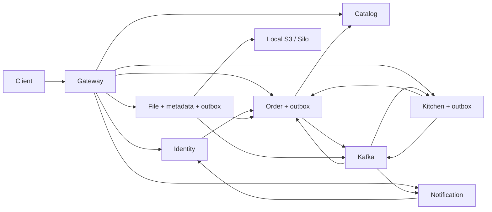

# Корпоративное питание — лабораторная 4

Собственная кухня, постоянное меню, заказы организаций и ручное подтверждение заказа целиком. Сохранены функции и безопасность лабораторий 1–3; добавлены Kafka, внутренние уведомления, файлы и Clean Architecture.

[Карта проекта со схемами: архитектура, конфиги, что сделано и где искать код](docs/PROJECT-MAP.md).

## Запуск

Нужны Docker, Java 21, Python 3 и OpenSSL. Создать локальные секреты один раз:

```bash
python3 scripts/setup-env.py
python3 scripts/write-admin-access.py
docker compose up -d --build --wait --wait-timeout 600
```

`setup-env.py` создаёт `.env` с правами `600`, случайными паролями и RSA-ключами. Существующий файл он сохраняет. Настройки для самостоятельного заполнения — в [.env.example](.env.example). Bootstrap создаёт первого супервизора только на пустой базе; его логин и пароль находятся в `.env`.

Демонстрационные роли, справочники и отправленный заказ можно создать через настоящий API: `python3 scripts/seed-demo.py --env-file .env`. Доступы сохранятся только в локальный `CREDENTIALS.local.md`, который игнорируется Git.

При стандартном порте:

- [Swagger UI](http://localhost:8080/swagger-ui/index.html) — выбор сервиса и Authorize;
- [readiness](http://localhost:8080/actuator/health/readiness);
- OpenAPI: `/v3/api-docs`, `/v3/api-docs/catalog`, `/v3/api-docs/kitchen`, `/v3/api-docs/identity`, `/v3/api-docs/notifications`, `/v3/api-docs/files`.

`HTTP_PORT` и `COMPOSE_PROJECT_NAME` позволяют запускать лабораторные в отдельных окружениях. В текущем checkout локальный порт задан в `.env`; данные находятся в именованных Docker volumes. Остановка с сохранением данных: `docker compose stop`.

Config Server использует отдельный Git-репозиторий [high_load_configs, ветка lab4](https://github.com/Vediusse/high_load_configs/tree/lab4): общие свойства в `application.yml`, отдельные — в `<service>/application.yml`. Секреты передаются через окружение. `CONFIG_REPO_URI` и `CONFIG_REPO_LABEL` задаются в `.env`. Локальная Git-копия также поддерживается; порядок настройки описан в [документации запуска](docs/lab4-run.md).

## Стиль и статический анализ

Java и Maven POM форматируются Spotless; для Java используется Google Java Format (AOSP, отступ 4 пробела). В `verify` входят проверка формата, PMD и ArchUnit. Wildcard-import запрещены, неиспользуемые импорты удаляются автоматически. PMD проверяет неиспользуемый код, лишние конструкции, работу с ресурсами и проверки `null`; XML-отчёт находится в `<module>/target/pmd.xml`.

```bash
JAVA_HOME=$(/usr/libexec/java_home -v 21) ./mvnw spotless:apply
JAVA_HOME=$(/usr/libexec/java_home -v 21) ./mvnw spotless:check
```

В application передаются собственные `Request`/`Command`/query-объекты для составных операций, например `UploadFileCommand` и `OrderSearch`. Для простого поиска по `id` или смены статуса с ожидаемой версией используются обычные типизированные параметры. HTTP, JWT и multipart разбираются во входных адаптерах.

## Проверка

Все unit-тесты, интеграционные тесты с PostgreSQL и настоящим кластером из трёх Kafka-брокеров, ArchUnit и порог JaCoCo 70%:

```bash
DOCKER_AUTH_CONFIG='{"auths":{}}' JAVA_HOME=$(/usr/libexec/java_home -v 21) ./mvnw clean verify
```

В Linux достаточно `./mvnw clean verify`, если `JAVA_HOME` указывает на Java 21. Testcontainers поднимает собственные контейнеры; предварительный запуск Compose для Maven не нужен.

Проверки запущенного окружения:

```bash
python3 scripts/lab4-notifications-smoke.py --env-file .env
python3 scripts/lab4-files-smoke.py --env-file .env
python3 scripts/lab4-outbox-smoke.py --env-file .env --failure-tests
```

Для другого порта передать `--base-url http://localhost:PORT`. Сценарии создают демонстрационные данные. Последняя команда временно останавливает Kafka и Notification и проверяет восстановление. Подробные команды защиты и повторной доставки — в [docs/lab4-run.md](docs/lab4-run.md).

## Postman

Четыре независимые повторяемые папки: бизнес-флоу, файлы/S3, уведомления и runtime
конфигурация; внутри — подготовка, основной путь и отдельные проверки в подпапках.
Импортировать [коллекцию lab4](postman/lab4.postman_collection.json)
и локальный environment, который создаёт `python3 scripts/setup-postman.py`.
PDF встроены, ID/версии/JWT заполняются автоматически. [Импорт и демонстрация](postman/README.md).

## Сервисы и данные

| Сервис | Ответственность |
| --- | --- |
| Catalog | Категории, блюда, активное меню и текущие цены; PostgreSQL/R2DBC |
| Order | Организации, точки, заказ, снимки цен, история, квитанции команд, ссылки на файлы; PostgreSQL/JPA |
| Kitchen | Синхронные команды приготовления и локальная проекция; PostgreSQL/JPA |
| Identity | Пользователи, роли, BCrypt, вход, проверка текущего состояния пользователя, внутренний JWT; PostgreSQL/JPA |
| Notification | Внутренняя лента и обработанные события; отдельная PostgreSQL |
| File | Метаданные, доступ, checksum и логическое удаление; отдельная PostgreSQL и локальный S3 |
| Gateway | Единственный опубликованный HTTP-вход и обмен JWT |
| Discovery / Config | Eureka и конфигурация из Git |

Всего: девять приложений, шесть PostgreSQL, три Kafka-брокера и S3 Silo (поддерживаемая ветка MinIO). `common` — библиотека; `kafka-init` и `s3-init` настраивают инфраструктуру и завершаются.



## Надёжность и безопасность

Каждый новый защищённый внешний запрос допускается через Gateway → Identity. Внутри цепочки используется короткий RS256 JWT, который сервисы проверяют локально. Роли и организация ограничивают доступ к объектам; супервизор управляет пользователями и не получает автоматически бизнес-права. Swagger открыт, его бизнес-запросы требуют Bearer token.

Изменение состояния, история и outbox создаются в одной локальной транзакции владельца. Relay отмечает событие отправленным только после Kafka ack. Повторы сохраняются и доставляются снова; consumer записывает `eventId` вместе с эффектом. Для неверных сообщений предусмотрены ограниченные повторы и реплицируемый DLT. Синхронные команды и проверка прав остаются синхронными.

Топики `order-events`, `production-events`, `file-events` имеют по три partition, replication factor 3 и `min.insync.replicas=2`. Ключ — `orderId`. Содержимое событий — идентификаторы и необходимые версии; JWT, пароли и контакты не сохраняются.

Файлы хранятся в локальном S3 bucket `order-files`, PostgreSQL хранит метаданные. В Kafka передаются только события о файлах. Консоль S3: [localhost:19001](http://localhost:19001), доступы — в игнорируемом `ADMIN-ACCESS.local.md`. Spring Cloud Bus передаёт сигналы обновления через `runtime-config-events`, значения перечитываются из Git без перезапуска. [Схема и сценарий демонстрации](docs/lab4-s3-runtime.md).

Domain не зависит от Spring, ORM, Kafka и файловой системы. Application использует порты; REST/Kafka — входные адаптеры, БД/Feign/storage — выходные. Для JPA-агрегатов ORM mapping вынесен в инфраструктурные XML. Границы проверяет ArchUnit во всех шести бизнес-сервисах.

## Новые API

- `GET /api/v1/notifications?page=&size=` — собственная лента, максимум 50;
- `POST /api/v1/notifications/{id}/read` — идемпотентная отметка прочтения;
- `POST /api/v1/files` — multipart `orderId`, `relationType`, `file`, ответ `201`;
- `GET /api/v1/files/{id}` — скачивание после проверки доступа к заказу и checksum;
- `DELETE /api/v1/files/{id}` — логическое удаление владельцем, `204`;
- `GET /api/v1/orders/{id}/files?page=&size=` — актуальные метаданные File Service;
- `GET /api/v1/orders/{id}/file-references?page=&size=` — событийная проекция ID/типов файлов в Order.
- `GET /api/v1/files/settings` — применённый лимит/MIME и версия настроек, только `SUPERVISOR`.

`SPECIFICATION` загружается для подтверждённого, готовящегося, готового или выданного заказа. `DISCREPANCY_ACT` — для готового или выданного. По умолчанию разрешены PDF/PNG/JPEG до 10 MiB; проверяются MIME, сигнатура и SHA-256. Исходное имя не используется как путь. Логическое удаление сохраняет бинарные данные и метаданные; физическая очистка не запускается автоматически.

Подробности: [архитектура](docs/architecture.txt), [проектные решения lab4](docs/lab4-design.txt), [контракт безопасности](docs/security/lab3-contract.txt), [базовый бизнес-сценарий](docs/lab1-defense.md).
