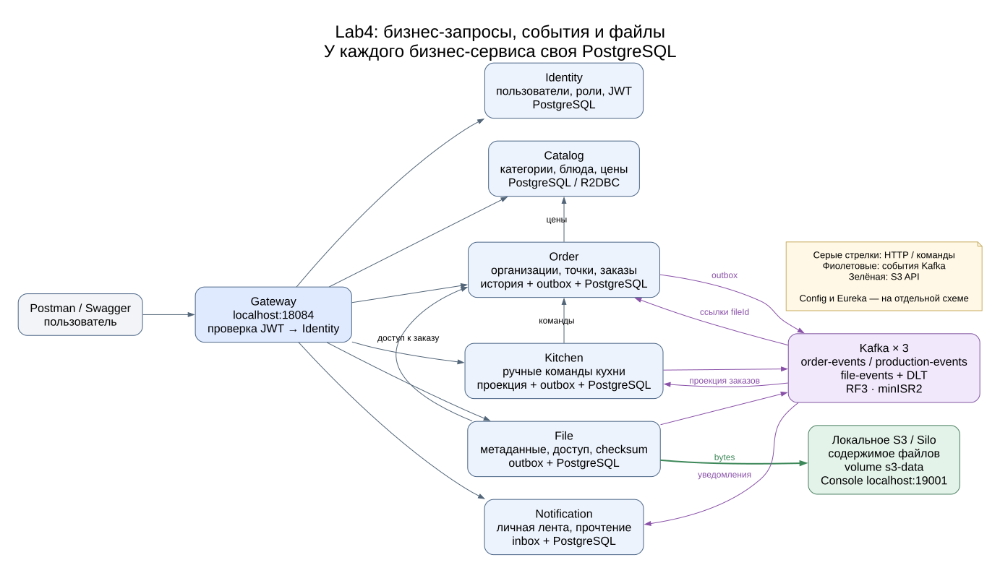
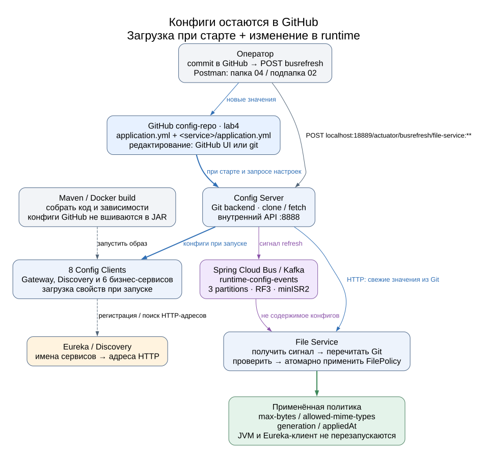

# Карта проекта: что работает и где это находится

Рабочая лабораторная 4: `/Users/rublev/DEV/high_load_lab4`, ветка `feature/lab4`.
Отдельная копия репозитория конфигов: `/Users/rublev/DEV/high_load_configs_lab4`,
ветка `lab4`. Принятая lab3 находится в исходной папке `high_load`; lab4 развивается
в своём checkout. Текущий стенд — Docker Compose `high-load-lab4`.

## Архитектура



Пользователь обращается к Gateway. На каждый защищённый запрос Gateway проверяет
пользователя через Identity и получает короткий внутренний JWT. Бизнес-сервисы
проверяют его локально и применяют роли/права на организацию и заказ.

Order владеет организациями и заказами, сохраняет снимки цен и единолично меняет
статус заказа. Kitchen передаёт ему ручные команды подтверждённого бизнес-цикла.
Актуальные цены принадлежат Catalog. Состояние и outbox записываются одной
транзакцией; relay публикует события в Kafka. Notification строит личную ленту,
Kitchen — проекцию заказов, Order — ссылки на файлы. Повторы подавляются inbox.

У шести бизнес-сервисов отдельные PostgreSQL. File хранит в своей БД метаданные,
размер, SHA-256 и права владения; содержимое находится в локальном S3 Silo, ветке
MinIO. Kafka и Git содержимое пользовательских файлов не получают.

Всего: 9 приложений + 6 PostgreSQL + 3 брокера Kafka + 1 S3. `kafka-init` и
`s3-init` настраивают инфраструктуру и завершаются. Kafka topics имеют RF3 и
minISR2; S3 — один локальный узел с постоянным Docker volume.

## Конфиги: сборка, запуск, runtime — разные моменты



| Момент | Что фактически происходит |
| --- | --- |
| `mvn package` / Docker build | Компилируются код и зависимости. Рабочие свойства из GitHub не копируются в JAR. В JAR остаются имя сервиса и адрес подключения к Config Server. |
| Запуск Config Server | Git backend клонирует `high_load_configs`, ветка `lab4`. Локальный override для текущего стенда выключен. |
| Запуск остальных приложений | `spring.config.import=configserver:...` получает общие и сервисные свойства. Секреты подставляются из окружения клиента. |
| Изменение в runtime | Новый commit в `lab4` → POST busrefresh → сигнал Kafka → клиент перечитывает Git → применяет проверенную политику. Пересборка JAR и перезапуск JVM не нужны. |

Это стандартная модель [Spring Cloud Config Client](https://docs.spring.io/spring-cloud-config/reference/4.3/client.html).
Сейчас получение происходит **при запуске**. Это отличается от получения при
сборке. Загрузка именно при сборке означала бы зафиксированный снимок внутри артефакта;
сейчас конфигурация вынесена наружу и остаётся централизованной.

Динамически применяются `files.max-bytes` и `files.allowed-mime-types`. Если новое
значение невалидно, File сохраняет последнюю рабочую политику. Endpoint S3, ключи,
bucket, соединения с БД/Eureka и жёсткий предел размера относятся к запуску.
Kafka передаёт **сигнал обновления**, значения по-прежнему приходят из GitHub.
Отдельного хранилища временных UI-оверрайдов поверх Git сейчас нет.

Соседний `high_load_configs_lab4` — рабочая Git-копия для редактирования и push.
Сам Config Server берёт данные напрямую с GitHub и создаёт собственный checkout
`/tmp/config-repo-*` внутри контейнера. Host-копия к нему сейчас не примонтирована.

## Интерфейс редактирования конфигов

Сохранён готовый интерфейс GitHub с историей изменений:

1. [Открыть настройки File в GitHub](https://github.com/Vediusse/high_load_configs/blob/lab4/file-service/application.yml).
2. Нажать Edit, поменять `files.max-bytes`, например на `2048`, и сделать commit
   **в ветку lab4**. Это можно сделать целиком в браузере.
3. В Postman выставить `expectedFileMaxBytes=2048`. Если сценарий ещё не готовили,
   запустить папку 04 целиком; иначе выполнить подпапку **«Применить Git commit
   через Kafka»** и затем **«После изменения»**.
4. Посмотреть применённые `maxBytes`, `generation`, `appliedAt`; большой PDF
   получает `413`, маленький — `201`.
5. В GitHub вернуть `${FILE_MAX_BYTES:10485760}`, сделать commit и повторить
   refresh с `expectedFileMaxBytes=10485760`.

GitHub поддерживает [редактирование и commit через веб-интерфейс](https://docs.github.com/en/repositories/working-with-files/managing-files/editing-files).
После веб-правок локальную копию конфигов следует обновить `git pull --ff-only`
в `high_load_configs_lab4` перед дальнейшим использованием CLI-helper.

### Какие готовые отдельные панели существуют

| Решение | Что умеет | Как соотносится с нашим config-repo |
| --- | --- | --- |
| [GitHub Web Editor](https://docs.github.com/en/repositories/working-with-files/managing-files/editing-files) | Редактирование YAML, diff, commit, история | Уже подходит: сохраняет именно наш Git. Refresh выполняется через Postman/Bus. |
| [Spring Boot Admin](https://docs.spring-boot-admin.com/3.4.6/faq/) | Состояние приложений, просмотр Environment, изменение/refresh свойств при настройке Actuator | Само изменение Environment не является commit в Git. Это дополнительная панель наблюдения, а не замена нашего Git-процесса. |
| [Nacos](https://nacos.io/en/docs/v3.2/guide/admin/console-guide/) | Полноценная конфигурационная консоль, версии, rollback, доставка изменений | Отдельная система хранения/доставки; сохранение в текущий GitHub config-repo потребует дополнительной интеграции. |
| [Spring Cloud Config Admin / SCCA](https://github.com/dyc87112/spring-cloud-config-admin) | UI и REST над Spring Cloud Config, включая Git backend | Подходит по идее, но последнее обновление репозитория — июнь 2022; совместимость с нашим Boot 3.5/Cloud 2025 и YAML не подтверждена. Подключением одной зависимости это не становится. |

Существующий Config Server не заменён Nacos, SCCA или другим хранилищем.
Для текущей защиты доступен рабочий путь **GitHub UI → Kafka refresh → действующая
политика**, без разработки собственного редактора и без второго источника истины.

## Где искать код и результаты

| Часть | Где находится | Что там сделано |
| --- | --- | --- |
| HTTP-вход и допуск | `gateway-service/` | Маршруты, обращение к Identity, внешний/внутренний JWT. |
| Пользователи | `identity-service/` | Роли, BCrypt, вход, состояние пользователя, внутренние токены. |
| Меню | `catalog-service/` | Категории, блюда, цены; реактивный R2DBC. |
| Организации и заказы | `order-service/` | Организации/точки, заказ, снимок цены, история, optimistic locking, outbox, ссылки fileId. |
| Кухня | `kitchen-service/` | Ручные команды, идемпотентные receipt и событийная проекция. |
| Файлы | `file-service/` | Метаданные/права/checksum, S3-адаптер, перенос старого volume, runtime FilePolicy; скачивание исходных байтов с корректным именем. |
| Уведомления | `notification-service/` | Kafka consumers, inbox, персональная лента и отметка прочтения. |
| Конфигурация | `config-service/` и отдельный `high_load_configs` | Git backend, защищённый Bus refresh; общие и сервисные YAML. |
| Поиск сервисов | `discovery-service/` | Eureka. |
| Общая инфраструктура Java | `common/` | Outbox/inbox, безопасность, ошибки, пагинация и выполнение блокирующих вызовов. |
| Docker и инициализация | `compose.yaml`, `infra/kafka/`, `infra/s3/` | 3 брокера, топики/репликация, приватный S3 bucket и отдельный ключ File. |
| Демонстрация API | `postman/` | 4 родительские папки с подпапками; PDF спецификации/акта формируются клиентом из ответов текущего заказа, затем загружаются в File. |
| Проверки/демо из терминала | `scripts/` | Запуск smoke, генерация демоданных, environment и Git/runtime helper. |
| Читаемость и архитектура | `pom.xml`, `config/quality/pmd.xml`, `*CleanArchitectureTest.java` | Spotless, PMD, ArchUnit; домен без Spring/ORM/Kafka/S3. |
| Планы и локальные отчёты | `AI/state/`, `AI/high-load-lab-4/` | Контрольные точки и доказательства; локальная папка исключена из Git. |

В каждом бизнес-сервисе: `domain` — модель и правила; `application` — сценарии и
порты; `adapters/in` — HTTP/Kafka; `adapters/out` — БД/Feign/S3; `configuration` —
Spring wiring. Техническим Config/Gateway/Discovery искусственные домены не нужны.

Данные работающего стенда находятся в именованных Docker volumes, а не в исходниках:
шесть PostgreSQL volumes, `kafka-1-data`/`kafka-2-data`/`kafka-3-data`, `s3-data`.
Compose добавляет к именам префикс проекта `high-load-lab4`. Silo монтирует свой
volume в `/data`; старый `files-data` оставлен File Service как `/legacy-files:ro`.
На macOS эти volumes управляются Docker Desktop внутри его VM.

## Что добавили в lab4 поверх lab3

1. Разделили бизнес-сервисы на domain/application/adapters, вынесли ORM mapping,
   добавили ArchUnit, форматирование Spotless, статический анализ PMD и Lombok
   для простых конструкторов/аксессоров.
2. Подняли три брокера Kafka; добавили outbox/inbox, повторную доставку, DLT,
   внутренние уведомления и проекции Kitchen/Order.
3. Добавили File Service, затем локальное S3 вместо файлового адаптера. Старые
   файлы перенесены с проверкой SHA-256, предыдущий volume сохранён read-only.
4. Сохранили Git config-repo и добавили runtime refresh через Kafka: проверенная
   политика меняется атомарно, соединения S3/БД/Eureka не пересоздаются.
5. Подготовили повторяемые Postman-сценарии, PDF-примеры, генерацию локального
   environment, проверки отказов и инструкции демонстрации.

## Что открыть на защите

| Адрес/файл | Для чего |
| --- | --- |
| [Swagger](http://localhost:18084/swagger-ui/index.html) | API всех бизнес-сервисов и вход. |
| [S3 Console](http://localhost:19001) | `order-files/documents`: реальные локальные объекты. |
| [Config health](http://localhost:18889/actuator/health) | Config Server работает. У корня `:18889/` нет страницы; `404` ожидаем. |
| `GET /api/v1/files/settings` | Действующая политика; нужен JWT SUPERVISOR. Есть в Swagger File и Postman runtime. |
| [Postman: импорт и сценарии](../postman/README.md) | Что запускать по папкам и как скачать PDF/показать Visualize. |
| `CREDENTIALS.local.md` | Локальные бизнес-роли и ID. |
| `ADMIN-ACCESS.local.md` | Локальные доступы S3/Config operator. |
| `DEMO-FILES.local.md` | Созданные проверкой новые PDF: пользователь и ID для скачивания через Swagger; приватный локальный файл. |
| [Проверки lab4](lab4-validation.txt), [проверки Postman](../postman/validation.txt) | Результаты фактических прогонов. |

Исходники схем — `docs/diagrams/*.dot`; готовые картинки — SVG и PNG рядом.
Перегенерация при установленном Graphviz:

```bash
dot -Tsvg docs/diagrams/services.dot -o docs/diagrams/services.svg
dot -Tpng docs/diagrams/services.dot -o docs/diagrams/services.png
dot -Tsvg docs/diagrams/configuration.dot -o docs/diagrams/configuration.svg
dot -Tpng docs/diagrams/configuration.dot -o docs/diagrams/configuration.png
```
