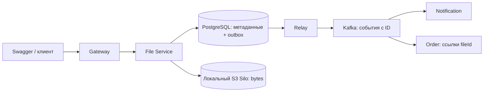
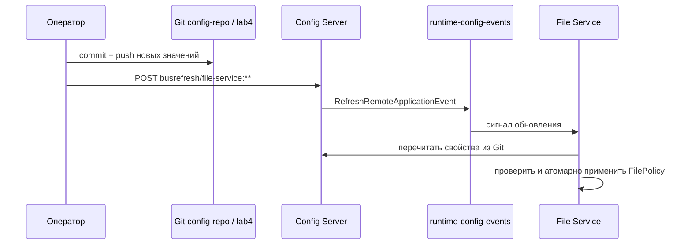

# Локальное S3 и runtime-конфигурация

Команды выполняются из `/Users/rublev/DEV/high_load_lab4`. Swagger стенда:
[localhost:18084](http://localhost:18084/swagger-ui/index.html).

## Где что хранится



Это обычная схема хранения файлов. В PostgreSQL `file_document` находятся ID,
заказ, загрузивший пользователь, имя, MIME, размер, SHA-256, storage key,
статус и даты. В таблице нет содержимого файла. S3 bucket `order-files` хранит
объекты `documents/<storage_key>`. Имя, присланное пользователем, не становится путём.
Организация и текущий доступ проверяются через Order. Kafka получает только
события загрузки/удаления с идентификаторами и версиями.

Используется [Silo](https://github.com/pgsty/silo), поддерживаемая ветка MinIO с
S3 API и полной веб-консолью. Образ закреплён по версии и digest. File Service
работает через AWS SDK `S3Client` с явно заданным `http://s3-storage:9000`;
облачного endpoint и файлового fallback нет. Объекты остаются в локальном Docker
volume `high-load-lab4_s3-data`. Git и Kafka содержимое файлов не получают.

S3 находится в отдельной Docker-сети с File Service и инициализатором. API и
консоль опубликованы только на `127.0.0.1`. Bucket приватный, у File Service свой
ключ только для чтения/записи/удаления `documents/*` в этом bucket.

## Что показать преподавателю

1. Открыть [S3 Console](http://localhost:19001). Логин/пароль —
   `ADMIN-ACCESS.local.md`; создать его заново: `python3 scripts/write-admin-access.py`.
   Файл локальный, с правами `600`, игнорируется Git.
2. В Swagger войти как `ORGANIZATION_REPRESENTATIVE` из `CREDENTIALS.local.md`.
   Для подтверждённого заказа загрузить PDF через `POST /api/v1/files`:
   `orderId`, `relationType=SPECIFICATION`, `file`. Подтверждение делает
   `KITCHEN_MANAGER`, используя текущую `expectedVersion`.
3. В консоли открыть `order-files → documents`: появился UUID-объект.
   В ответе API сохранить `id`, затем скачать его через `GET /api/v1/files/{id}`.
4. Показать метаданные в PostgreSQL:

```bash
docker compose exec file-postgres sh -c 'psql -U "$POSTGRES_USER" -d "$POSTGRES_DB" -c "select id,order_id,storage_key,original_name,mime_type,size,checksum,status from file_document order by uploaded_at desc limit 5"'
```

S3 API: [localhost:19000](http://localhost:19000). Анонимное чтение bucket даёт
`403`; смотреть объекты следует через авторизованную консоль или File API.
Логическое удаление скрывает файл в API, сохраняя bytes и метаданные.

Проверка отказа S3: остановить хранилище, попробовать загрузку (ожидается `503`),
затем восстановить его. PostgreSQL и File Service продолжат работать:

```bash
docker compose stop s3-storage
docker compose up -d --no-deps --wait s3-storage
```

Старые файлы автоматически перенесены из прежнего volume при обновлении.
Копирование ограничено по размеру, SHA-256 сверяется до и после. Старый volume
сохранён read-only как `/legacy-files`. Таблица `file_storage_migration` хранит
успешное завершение; частично выполненный перенос можно продолжить при запуске.

## Как работает runtime



Это [Spring Cloud Bus Kafka](https://docs.spring.io/spring-cloud-bus/reference/spring-cloud-bus/bus-endpoints.html).
**Kafka передаёт сигнал обновления, значения приходят из Git.** Все девять
приложений подключены к Bus. Топик `runtime-config-events`: 3 partition, RF3,
`min.insync.replicas=2`. Это отдельный поток от бизнес-событий и уведомлений.

В runtime изменяются `files.max-bytes` и `files.allowed-mime-types`. Невалидный
набор не заменяет последний рабочий. S3 endpoint/bucket/ключи и жёсткий предел
10 MiB задаются при старте; для их замены нужен перезапуск. Снижение лимита
загрузки не закрывает скачивание уже сохранённых более крупных файлов.

## Демонстрация без перезапуска

1. В Swagger войти как **SUPERVISOR**, File → `GET /api/v1/files/settings`.
   Показать `limits.maxBytes`, `generation`, `appliedAt`, `lastRejection`.
2. В `/Users/rublev/DEV/high_load_configs_lab4/file-service/application.yml`
   заменить `max-bytes: ${FILE_MAX_BYTES:10485760}` на `max-bytes: 2048`.
   Сделать commit и push в ветку `lab4` репозитория
   [high_load_configs](https://github.com/Vediusse/high_load_configs/tree/lab4).
3. Из checkout приложения выполнить:

```bash
git -C ../high_load_configs_lab4 add file-service/application.yml
git -C ../high_load_configs_lab4 commit -m "Change runtime file upload limit"
git -C ../high_load_configs_lab4 push origin HEAD:lab4
python3 scripts/refresh-config.py --destination 'file-service:**'
```

4. Снова вызвать `GET /api/v1/files/settings`: лимит стал `2048`, generation
   увеличилась. Под представителем новый PDF больше 2 KiB получает `413`, маленький
   проходит. Ранее загруженный большой файл продолжает скачиваться.
5. Вернуть исходную строку с `${FILE_MAX_BYTES:10485760}`, commit/push и повторить
   refresh. Лимит вернётся к 10 MiB.

Процесс File Service не пересоздаётся; время запуска можно сравнить до/после:

```bash
docker inspect high-load-lab4-file-service-1 --format '{{.State.StartedAt}}'
docker compose exec kafka-1 /opt/kafka/bin/kafka-topics.sh --bootstrap-server kafka-1:9092 --describe --topic runtime-config-events
docker compose exec kafka-1 /opt/kafka/bin/kafka-console-consumer.sh --bootstrap-server kafka-1:9092 --topic runtime-config-events --from-beginning --max-messages 1 --timeout-ms 10000
```

Config management доступен только на localhost:18889; отдельные доступы находятся
в `ADMIN-ACCESS.local.md`. Helper передаёт их сам. Без авторизации refresh даёт
`401`, произвольная подмена свойств через `busenv` запрещена. Бизнес-супервизор и
Config operator — разные учётные записи; Kafka не получает их пароли.

## Проверки

```bash
DOCKER_AUTH_CONFIG='{"auths":{}}' JAVA_HOME=$(/usr/libexec/java_home -v 21) ./mvnw clean verify
python3 scripts/lab4-files-smoke.py --env-file .env --base-url http://localhost:18084
```

Maven запускает настоящий S3 в Testcontainers: сохранение/скачивание, права,
checksum, rollback, недоступность/восстановление S3 и повторяемый перенос старых
данных. Отдельные тесты проверяют атомарную замену политики и отказ от неверных
значений. Smoke создаёт свои данные и проверяет S3, события и ссылки Order.
